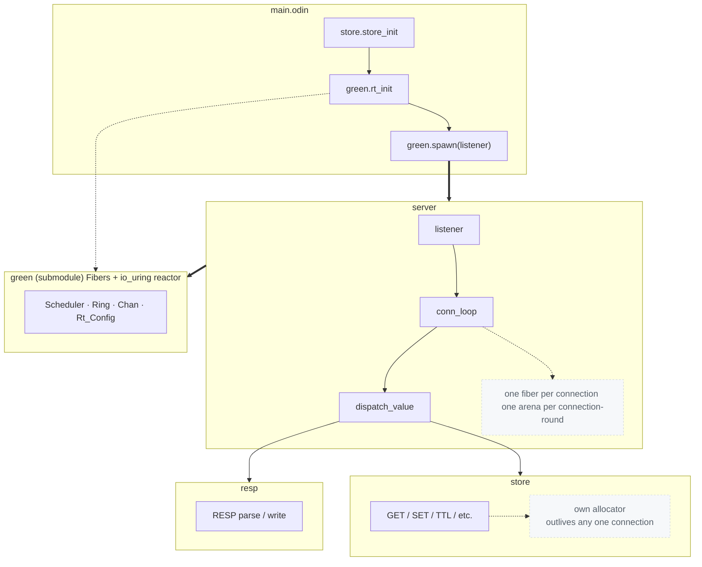

# hydracrawl

A Redis-compatible server written from scratch in [Odin](https://odin-lang.org),
on top of a hand-built cooperative runtime (`green`) backed directly by
Linux `io_uring`. No OS threads per connection, no green-thread library
borrowed from elsewhere — the scheduler, the stack switching, the async
reactor, the RESP protocol, and the command set are all written here.

```
76 unit/integration tests, all green · ~30k ops/s headline throughput
0 crashes across every stress scenario · single-core, single-thread
```

## Why this exists

The goal was to see how far a single OS thread, cooperative green tasks,
and `io_uring` can go toward a real Redis server — no thread-per-connection,
no `epoll` callback soup, no borrowed async runtime. Everything from the
context switch up is written and tested in this repo.

## Architecture



### `green` — the runtime (`src/green`, a submodule)

Everything a Redis clone needs from an async runtime, built from first
principles:

- **Fibers.** Each task gets its own `mmap`'d stack with a guard page below
  it (an overflow faults immediately instead of corrupting a neighbor), and
  a hand-written x86-64 context switch (`context_switch.s`) that saves/
  restores just the callee-saved registers needed to jump between a fiber
  and the scheduler.
- **`Ring`** wraps `io_uring` behind a generation-tagged slot pool: every
  in-flight request gets `index | generation` packed into `user_data`, so a
  stale completion arriving after its slot has been reused and reassigned
  is detected and dropped instead of waking the wrong task. Supports read,
  write, accept, connect, send, recv, timeout, cancel, and a raw escape
  hatch for anything else `io_uring` can do.
- **`Scheduler`** runs one step at a time: drain completions non-blocking,
  wake whoever they belong to, pick the next ready fiber, and only fall back
  to a *blocking* kernel wait when there's truly nothing else to do.
- **`Chan(T, N)`** — fixed-capacity channels with real park/wake semantics
  (a full send or empty recv parks the fiber on a wait queue instead of
  spinning), used to implement blocking commands like `BLPOP`/`BRPOP`.
- **`Rt_Config`** makes every resource limit a runtime value instead of a
  compile-time constant: `max_fibers`, `max_requests`, `default_stack_size`.
  The run queue used to be a `Ring_Buffer(^Fiber, 1024)` — a hard, compile-
  time cap. It's now a `core:container/queue.Queue`, which was only adopted
  after checking its actual source: it indexes with modulo arithmetic over
  a `[dynamic]T`, so popped-from-front slots really do get reused, not
  wasted — the concern that ruled out a naive FIFO. `max_requests` stays a
  real, enforced cap (slab-backed, `io_uring` needs fixed-size submission
  slots), everything else grows on demand.
- **Stress-tested, not just claimed.** A dedicated suite spawns 10x the old
  1024-fiber cap from a deliberately tiny starting capacity to prove growth
  actually happens, parks thousands of channel senders/receivers under
  load, and drives `max_requests` to its exact configured ceiling with real
  blocked I/O to confirm it's a hard cap that reuses slots correctly rather
  than silently overflowing.

### `resp` (`src/resp`)

A combinator-based RESP2 parser and writer (`Bulk_String`, `Simple_String`,
`Integer`, `Error`, `Array`). Benchmarked at ~4.8µs/op to parse one `SET` —
by its own code comment, the known-slow, correctness-first tradeoff; a
hand-rolled parser is the documented next step if that ever matters.

### `store` (`src/store`)

An in-memory key/value map with TTL (`EXPIRE`, `PERSIST`, lazy expiry on
read). Pinned to its own allocator at `store_init` time, independent of
whatever per-connection arena happens to be ambient — so a value a
connection SETs outlives that connection's own short-lived memory.

### `server` + `server/command` (`src/server`)

`listener` accepts connections forever; each one gets its own fiber
(`conn_loop`) and its own per-round memory arena (reset in bulk after every
request instead of freeing each parsed value individually). Commands are
looked up in a flat dispatch table and run against the shared `store`.

<details>
<summary>Supported commands (41)</summary>

| Category | Commands |
|---|---|
| Connection | `PING`, `ECHO` |
| Strings | `GET`, `SET`, `GETSET`, `GETDEL`, `GETRANGE`, `SETRANGE`, `APPEND`, `STRLEN`, `MGET`, `MSET`, `SETEX`, `SETNX`, `INCR`, `DECR`, `INCRBY`, `DECRBY`, `INCRBYFLOAT` |
| Lists | `LPUSH`, `RPUSH`, `LPOP`, `RPOP`, `LRANGE`, `LLEN`, `LINDEX`, `LINSERT`, `LREM`, `LSET`, `LTRIM`, `LMOVE`, `BLPOP`, `BRPOP` |
| Keys | `DEL`, `EXISTS`, `EXPIRE`, `TTL`, `PERSIST`, `TYPE`, `KEYS`, `SCAN`, `RENAME`, `RANDOMKEY` |

</details>

## Correctness discipline

Every claim in this README was measured, not assumed — the same standard
the code holds itself to:

- **Every test's allocator is checked, not just the ones that look bad.**
  `just test` runs under Odin's tracking allocator across every package;
  a clean run means `#Alloc == #Free` and `0 bytes` outstanding at exit for
  every single test, every time.
- **Cross-checked outside Odin's own allocator**, since raw syscalls
  (`mmap`, `io_uring` fds) are invisible to it: fiber stacks and `io_uring`
  mappings were audited mmap-for-munmap, and the standalone stress binary
  was run clean under Valgrind (`All heap blocks were freed -- no leaks are
  possible`).
- **Two real leaks found and fixed this way, not left as "acceptable":**
  an integration-test connection fiber was abandoned mid-`recv` because the
  test stopped driving the scheduler one tick before the peer's close
  actually got noticed (fixed by draining until only the permanent listener
  fiber remains); and a command reply's bytes were being allocated under
  the store's allocator but freed after the context had already been
  swapped back to the connection's arena (fixed by freeing before the
  restore, matching what the code's own comment already said should
  happen). The one leak that remains and is *actually* by design — the
  listener's permanently-blocked accept, abandoned once at test teardown —
  is called out explicitly in the test, not hidden.
- **Integration-tested end to end, no mocks:** the real `listener`, the
  real `io_uring` ring, real loopback sockets — multi-command sequencing on
  one connection, a malformed message getting a clean RESP error instead of
  a hang, and a value `SET` on one connection being visible to `GET` on a
  separate, later connection.

## Building and running

This project uses [`just`](https://github.com/casey/just) and requires the
Odin compiler on `PATH`.

```sh
git clone --recurse-submodules git@github.com:AzizMejbri/hydracrawl.git
cd hydracrawl

just build          # debug-friendly build -> build/hydracrawl
just run            # run from source
just release        # optimized build (-o:speed, native arch)
just test           # run every package's test suite
just check          # typecheck + vet every package
just bench          # build and run the benchmark suite
```

Run `just help` for the full recipe list (debugging under gdb/lldb,
profiling with `perf`/`callgrind`/`heaptrack`, `test-asan`/`test-tsan`).

Connect with any Redis client, or the bundled `resp_cli.py` for quick manual
testing:

```sh
./resp_cli.py PING
./resp_cli.py SET foo bar
./resp_cli.py GET foo
```

## Status

Actively developed, single-core only by design (see `TODO.md` for the
longer-term roadmap: a timer heap, fixed buffers/files, multishot
accept/recv, crash-safe persistence). Known, documented gaps rather than
silent ones: submitting past `max_requests` currently aborts the process
instead of parking the caller (no backpressure yet), and AddressSanitizer
can't be used on this codebase as-is — it misidentifies the runtime's own
manual stack switching as a stack-smashing bug (a documented false positive
in ASan itself, not a bug here).

## License

MIT — see [LICENSE](LICENSE). `src/green` is a separate project vendored as
a git submodule, under its own MIT license.
